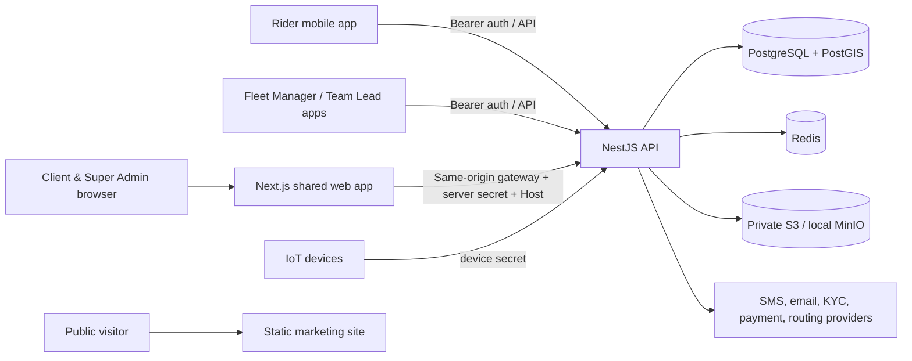

# EVs Eye — Consolidated Project Documentation

**Document status:** Consolidated from project documentation outside `flutter/`
**Last consolidated:** 2026-10-26
**Audience:** Engineering, product, operations, implementation partners and client onboarding

> This guide merges the repository documentation available at consolidation time. It is a curated, structured consolidation rather than a byte-for-byte archive: implementation facts, historical phase reports, operational plans, and proposed work are labeled separately. API details below are contracts captured by the source documents; the running API's Swagger/OpenAPI output and current code remain authoritative if they differ. Flutter/mobile source folders are intentionally excluded. Image and code/configuration assets remain in their original locations.

## Contents

1. [Product and scope](#1-product-and-scope)
2. [Architecture and repository](#2-architecture-and-repository)
3. [Runtime, data and security](#3-runtime-data-and-security)
4. [Local development and verification](#4-local-development-and-verification)
5. [Configuration and integrations](#5-configuration-and-integrations)
6. [Identity, onboarding and client operations](#6-identity-onboarding-and-client-operations)
7. [Fleet operations](#7-fleet-operations)
8. [Rider lifecycle and support](#8-rider-lifecycle-and-support)
9. [KYC and compliance](#9-kyc-and-compliance)
10. [Commercials, billing, payments and wallet](#10-commercials-billing-payments-and-wallet)
11. [Communications, localization and legal](#11-communications-localization-and-legal)
12. [Deployment and operations](#12-deployment-and-operations)
13. [Client discovery and implementation intake](#13-client-discovery-and-implementation-intake)
14. [Source document register](#14-source-document-register)
15. [Retained assets and references](#15-retained-assets-and-references)

## 1. Product and scope

EVs Eye is a multi-client electric-vehicle fleet operations platform. The platform supports client administration, fleet and hub operations, rider lifecycle, vehicle allocation/return, maintenance and inspections, KYC, billing and payments, operational notifications, and a separately deployed public marketing site. The application is an MVP with strict client isolation; features and workflows are controlled in part by versioned platform catalogs, packages, client configuration, and operational roles. The canonical roles are `ADVISOR`, `QC_MANAGER`, `SUPER_ADMIN`, `CLIENT_ADMIN`, `FLEET_MANAGER`, `TEAM_LEAD`, `KYC_OPERATOR`, and `RIDER`; former `RFD_MANAGER` users map to `ADVISOR`, and former `OPERATIONS_MANAGER` users map to `FLEET_MANAGER`.

The repository includes a web/API platform and integration contracts for separate mobile applications. Mobile endpoint guides are backend contracts; this repository's excluded `flutter/` directory and any separately maintained app repositories are outside this consolidation.

## 2. Architecture and repository

### 2.1 Applications and infrastructure

| Path | Responsibility |
| --- | --- |
| `apps/api` | NestJS API on Fastify; Prisma data access and migrations; auth, operations, integrations and API docs. |
| `apps/web` | Shared Next.js application for client operations and Super Admin/platform workspace. |
| `apps/site` | Separately built public static marketing site. |
| `infra` / `deployment` | Application cloud infrastructure, deployment support and environment examples. |
| `infra/site` | Independent Terraform root for the marketing site's S3/CloudFront/DNS/certificate resources. |
| `apps/api/prisma` | Prisma schema, migrations, seeders and catalog assets. |
| `docs` and `apps/api/docs` | This consolidated guide replaces the project documentation files in those paths. |

At runtime the API uses PostgreSQL and Redis. Local Compose adds MinIO for private S3-compatible media testing. Production storage uses private S3 and production integrations selected through environment configuration. Prisma migrations are deployed once as a release job before API replicas roll out. `/health` and `/health/ready` are health endpoints. Swagger is normally enabled outside production at `/api/docs`; OpenAPI JSON is `/api/docs-json`.

The web application and API are separate services. The web server calls the API through a same-origin server-side gateway. The gateway passes the incoming host and a server-only shared secret; the API independently verifies authenticated identity, current client membership/status, and host/client consistency. Hostnames supply routing context, never authorization. The marketing site is deployed independently and has no browser API credentials.

### 2.2 Data and response conventions

API success responses generally use `{ "data": ... }`. Errors use an error code/message and request identifier. Client-owned records are scoped using the authenticated client context and explicit `clientId` predicates or verified parent ownership. Platform catalogs are platform-owned. IoT ingestion uses a device credential and derives the client from the authenticated device. Signed media URLs are short-lived access links to private object storage; object keys, not expiring URLs, are persisted.

The primary migration for a fresh database is `20261016000000_init`, followed by subsequent migrations. This consolidated initial migration includes PostGIS extensions, triggers, check and overlap constraints, and custom indexes alongside the Prisma schema. Existing deployments with older migration history must baseline appropriately before using the consolidated initial migration. Normal `pnpm db:seed` populates catalog and local demo tenant data; it does not restore production/operational history.

### 2.3 Architecture diagram



## 3. Runtime, data and security

### 3.1 Client identity, hostname and authorization

`Client.id` is the authorization identifier; slug and company code are unique lookup/business fields. A client domain is resolved server-side. A verified explicit custom domain takes precedence over an implicit slug host. Unknown, reserved, malformed or unverified hosts must not fall through to another client's appearance. Reserved generic subdomains include `app`, `api`, `admin`, `platform`, `mail`, `smtp`, `cdn`, `media`, `assets`, `static`, `support`, and `status`; generic marketing/base hosts are not client tenants.

The API validates current active user and client state from the database, uses the database role rather than trusting token role claims, binds OTP and refresh flows to the resolved client, and checks host consistency. Client IDs supplied by browser forms are not authority. Super Admin uses the generic platform host. There is no PostgreSQL row-level security claim and no generic Prisma middleware: isolation depends on reviewed service/controller guards and explicit ownership checks, so new queries must follow the same discipline.

### 3.2 Browser sessions and gateway

Browser access/refresh credentials are HttpOnly, SameSite=Strict, host-only cookies; HTTPS uses `__Host-` names, `Secure`, `Path=/`, and no `Domain`. Local plain HTTP sets `SESSION_COOKIE_SECURE=false`. The gateway derives authorization from cookies and ignores browser Authorization headers. Mutating browser requests require exact Origin checks and cross-site fetch metadata is rejected; bodies are size bounded. Refresh sessions rotate once and session IDs allow logout/revocation. Native clients may use API bearer tokens.

Never expose `CLIENT_PROXY_SECRET`, provider credentials, or private tokens in `NEXT_PUBLIC_*` variables. API and Next server environments must use the same random gateway secret. Public context and proxy responses are no-store; authenticated HTML/API responses must not be cached across client hosts. Edge ingress should preserve the original Host and enforce per-IP abuse controls; the API's in-process throttle sees gateway traffic and is not a distributed per-user quota.

### 3.3 Storage and evidence

Local Compose provides MinIO. Client logos and media use presigned PUT/GET URLs; the browser uploads with the expected Content-Type and completes the upload through the API. Production uses private S3, IAM permissions, approved CORS origins, encryption and lifecycle controls. Do not make the bucket public. Client logos do not need `MEDIA_PUBLIC_BASE_URL`; signed URL TTL governs their validity. Upload completion validates storage metadata/evidence as described by each workflow.

## 4. Local development and verification

### 4.1 First run

```sh
cp .env.example .env
pnpm install
# Full local stack (migration and idempotent demo-seed jobs are included)
docker compose up --build
```

For non-Docker service startup, provide PostgreSQL and Redis, then run:

```sh
pnpm db:generate
pnpm db:migrate
pnpm db:seed
pnpm dev:api
pnpm dev:web
```

API defaults to port 3000 and web to 3001. The development seed includes client slug `yogmaya` and Client Admin mobile `+919871675222`; Super Admin development mobile is `+919100000000`, with development OTP `123456`. Treat these as local-only credentials. The platform workspace is at `http://localhost:3001/platform`.

### 4.2 Common commands

- `pnpm lint` — workspace lint scripts.
- `pnpm typecheck` — TypeScript checks.
- `pnpm test` — API unit and web gateway security tests.
- `pnpm test:e2e` — API end-to-end suite; requires configured services.
- `pnpm build` — workspace production builds.
- `pnpm verify` — typecheck, unit/gateway tests, then build.
- `pnpm test:client-access` — client access regression checks; requires local demo clients/database.

For database changes, edit `apps/api/prisma/schema.prisma`, create/apply a migration locally, and regenerate the Prisma client. For schema rebuilds in Compose, migrate before restarting API. Use targeted `docker compose build <service>` for faster app-only changes.

### 4.3 API discovery and manual acceptance

With local API running, browse Swagger at `http://localhost:3000/api/docs` and OpenAPI JSON at `http://localhost:3000/api/docs-json`. For protected endpoints, request and verify OTP then authorize with the returned token. IoT ingestion uses `x-device-secret`. Swagger is enabled outside production by default; `SWAGGER_ENABLED` can explicitly enable/disable it, and production disables it unless explicitly enabled. Existing anonymous controller response typing may show a generic `{data: ...}` success envelope in the schema; Try it out gives actual endpoint payloads.

A complete manual smoke test should authenticate a client admin, create rider/KYC/fleet/hub/components, upload media, allocate an available fleet, complete pre-allocation inspection, perform deallocation and post-inspection with required confirmations, ingest IoT location/heartbeat/start/stop packets, and verify dashboard/current-state data stays client-scoped. The release section adds the checklist.

## 5. Configuration and integrations

`.env.example` is the canonical local variable/default list. Secrets belong in a deployment secret manager, not Git. Principal variable groups:

| Area | Key variables / behavior |
| --- | --- |
| Runtime | `NODE_ENV`, `API_PORT`, `SWAGGER_ENABLED` |
| Database/cache | `DATABASE_URL`, `REDIS_URL` |
| Auth | Distinct `JWT_ACCESS_SECRET`, `JWT_REFRESH_SECRET`, `OTP_HASH_SECRET`; TTL, cooldown and attempt settings; `API_RATE_LIMIT`, `API_RATE_TTL_MS` |
| Web gateway/domains | `API_INTERNAL_URL`, matching API/Next `CLIENT_PROXY_SECRET`, `APP_BASE_DOMAINS`, `APP_GENERIC_HOSTS`, `SESSION_COOKIE_SECURE`; `NEXT_PUBLIC_API_URL` is public only. |
| Object storage | `S3_BUCKET`, `AWS_REGION`, optional local `S3_ENDPOINT`/`S3_PUBLIC_ENDPOINT`, signed URL TTL; production leaves local endpoints unset. |
| SMS/KYC | `SMS_PROVIDER` plus provider settings; `KYC_PROVIDER` and KYC settings. Production must use real, supported adapters. |
| Email | `EMAIL_PROVIDER`, MSG91 domain/from/template/auth key, and `CLIENT_LOGIN_URL`. |
| Payments | `PAYMENT_PROVIDER`, Cashfree environment/credentials/webhook/return URLs; provider defaults may be disabled. |

### OTP purposes

Active SMS OTP flows are login, Rider/operator handover confirmation, return-penalty approval, and vehicle-submission handover confirmation for the Rider and primary Team Lead. `PHONE_VERIFICATION` had no caller and has been removed from the current enum; the forward migration removes any old OTP request rows with that obsolete purpose.

### 5.1 SMS and email

SMS is abstracted behind a provider; Telipia settings include verified HTTPS API URL, username/API key, registered sender, route (default `TRANS`), approved login DLT template ID and optional deallocation template ID. Console SMS is development-only. Production must use a real approved provider and templates.

Client welcome email uses `EmailProvider`, with MSG91 or disabled implementation. After successful Super Admin client onboarding (not draft save), a welcome email is attempted after transaction commit. Configure `EMAIL_PROVIDER=msg91`, secret `MSG91_AUTH_KEY`, verified `MSG91_EMAIL_DOMAIN`, `MSG91_EMAIL_FROM`, published `MSG91_WELCOME_TEMPLATE_ID`, and public HTTPS `CLIENT_LOGIN_URL`. Template variables: `client_name`, `company_name`, `company_code`, `registered_mobile_number`, `login_url`; subject: “Welcome to EVs Eye — Your account is ready”. Provider acceptance is not proof of inbox delivery. Failures do not roll back or duplicate clients; retries are not automatic. Check MSG91 logs before manually resending.

### 5.2 Payments

Payment adapters are server-side ports. Cashfree hosts are fixed HTTPS sandbox/production endpoints; production requires production mode and HTTPS return/webhook URLs. Provider operations use idempotency keys, sanitized errors and bounded timeouts. A timeout on a mutating provider operation means unknown outcome and requires reconciliation before another operation. Verify provider state server-side; never treat a redirect as payment proof. Detailed provider flows are summarized in section 10.

## 6. Identity, onboarding and client operations

### 6.1 Configured client login

Super Admin configures login using Feature Step, Feature and Package Feature. `LOGIN_IDENTIFIER` and `LOGIN_VERIFICATION` are children of `LOGIN`. Client apps fetch `GET /api/v1/auth/login-flow?companyCode=<code>&appCode=<app>`; verified client hostname can identify the tenant so company code is optional. Supported app codes: `RIDER_APP`, `CLIENT_PANEL`, `FLEET_MANAGER_APP`, `TEAM_LEADER_APP`. Super Admin login is separate.

Current supported flow is mobile number plus SMS OTP. Required included features are `CAPTURE_MOBILE_NUMBER`, `CAPTURE_LOGIN_OTP`, and `SEND_OTP_VIA_SMS`. `SEND_OTP_VIA_EMAIL` exists in catalog but is not offered until email OTP delivery and verification are implemented. Optional `configuration.loginAppCodes` limits availability per app; omission means every supported app. Role is checked against app before OTP is sent; OTP is bound to the app. OTP length, expiry, cooldown and attempts are server controlled.

### 6.2 Super Admin client setup and onboarding

Development Super Admin can onboard clients and create versioned rider-onboarding configurations using the immutable master-step catalog. Edit drafts and activate versions; activation archives the previous active version. Client-side requests to change master data/workflows are not exposed in the described slice; an approval workflow was intended as future work. Client onboarding email behavior is documented in section 5.

`Client.fleetOperatingMode` controls fleet-onboarding evidence behavior. `SIMPLE` permits activation without onboarding photos; `ONBOARDING_EVIDENCE` preserves required-photo activation policy. Evidence readiness is not the same as full allocation eligibility. Transaction evidence and other configured workflow gates still apply.

### 6.3 Client branding and custom domains

Client Admin branding settings support logo/favicon, colors, login title/subtitle and support contacts. PNG/JPEG/WebP only, 2 MB maximum; upload completion validates stored size, MIME and signature. SVG/HTML and arbitrary external asset/object URLs are rejected. Public host context exposes appearance fields only; no internal IDs, users or private configuration.

Super Admin manages domains for active clients. Own subdomains must match the slug; custom domains begin unverified. Publish TXT `_evseye-verification.<hostname>` with `evseye-verification=<verificationToken>`, then verify through the API/UI. Primary-domain changes are transactional; custom-domain TLS/routing must separately be provisioned. Deleting explicit own-subdomain mapping does not remove implicit slug hostname; disabling the client revokes access. See sections 3 and 12 for gateway and production routing requirements.

### 6.4 Commercial catalog and client-owned copies

Platform commercial subscriptions support quotes, subscription creation, vehicle-count updates, package vehicle tiers, feature add-ons, client add-on purchases, feature usage and maintenance operations. Catalog codes and package feature configuration drive app availability and commercial policy. Client onboarding copies active master records for some catalogs (spares/penalty prices and work partners); later client edits are independent, and re-import is idempotent/non-overwriting. Work-partner categories include food delivery, quick commerce, ecommerce, parcel/on-demand logistics, pharmacy/healthcare, specialty delivery and other. Bulk uploads validate rows and preserve import history/failure downloads; duplicate codes are reported rather than overwritten.

## 7. Fleet operations

### 7.1 Fleet, hub and asset catalogs

Fleet assets associate vehicle/OEM/type/model, hub, documents, battery/controller/IoT components and lifecycle status. The OEM image catalog is retained under `apps/api/prisma/catalog/assets/oem/`; see section 15. Hubs represent operations, parking, charging, swap, maintenance, warehouse or delivery functions. A client discovery intake should capture hub hierarchy/capacity, fleet ownership, registration, vehicle and component identifiers, charging/swap model and operating windows.

### 7.2 Allocation and commercial offer

Fleet Manager allocation flow can list a rider's available plans for an allocation, choose a plan, create/read a commercial offer and show it to the Rider for acceptance. Offer snapshots include rate card/version, currency, non-refundable onboarding amount, deposits and total. Fleet Manager endpoints also list active Team Leads, assign/view the primary Team Lead for an allocation, and enforce mandatory handover checks. Team Lead assignment and acceptance are client/hub/role scoped. Vehicle exchanges expose approve/reject, replacement selection/preview, offer/reject/accept, deposit reconciliation, handover/complete/cancel actions.

Commercial selection checks active agreement/allocation consistency. Existing exchange/return eligibility and price-version rules continue to apply; do not substitute current catalog values for frozen offer/agreement snapshots.

### 7.3 Installation, preparation and QC

Fleet installation supports staged workflow mode `STAGED_PREPARATION_QC`, while `SIMPLE`, `ONBOARDING_EVIDENCE`, and `PREPARATION_QC` retain their behavior. Mode changes do not silently copy/delete client data. Stage definitions can declare component type (`NONE`, battery, controller, IoT), dependencies, applicable hubs/vehicle types, independent verification, checklist items and photo types. Invalid/duplicate/cyclic dependencies and unsupported hub/type coverage are rejected. Hardware photo slots can be generated per installed component; clients should use API-returned `requiredPhotoTypes`, not hardcoded slot names.

Stage lifecycle includes paginated queues/details, inventory selection, claim/assign, checklist save, component association, submit, independent approve/reject, rework, upload intent/completion and scoped download URLs. Mutations are revision-based; stale revision conflicts protect concurrent edits. Failed required checks block submission; NA requires permission and reason. Submitted evidence is sealed. Fleet preparation/QC adds hub-scoped readiness before existing RFD/QC flow. Explicit admin allocation disablement is tracked; readiness and allocation gates remain separate.

### 7.4 Fleet Manager workbench

Fleet Manager home endpoint: `GET /api/v1/fleet-manager/home?hubId=<UUID>`. It returns live summary values, company GST/support details where configured, metric definitions and historical coverage. Yesterday history is available only from the recorded baseline coverage date; it is not reconstructed before that. Metrics include hub/rider attribution, pending allocation/submission, ready for deployment, maintenance, utilization, attendance and parking. Do not infer unsupported free-bay, service-bay, or open-job values.

Global scooter search: `GET /mobile-deployments/fleet-manager/fleets/search?search=<term>&page=1&limit=25`; detail: `/mobile-deployments/fleet-manager/fleets/:fleetId`. Results are hub-scoped; `canManage` describes hub access only and each action has separate authorization. Detail may include signed completed front photo, current allocation/rider and latest submission. Moving a scooter to a hub the manager cannot access is forbidden.

Maintenance fleet list/detail: `GET /api/v1/fleet-manager/maintenance/fleets` and `.../:fleetId`, with hub/search/pagination/status filters. `MAINTENANCE`, `BROKEN`, and `AWAITING_PARTS` count as under maintenance and cannot be allocated. Transition history records observed status changes; it is not guaranteed to provide a true maintenance start date for older data. Reports/evidence are scoped and exclude issue-only sensitive fields where specified.

### 7.5 Nearest hub and routing

Rider nearby-hub endpoint: `GET /api/v1/rider/hubs/nearby?latitude=...&longitude=...&radiusKm=...&limit=...`; client identity is taken from Rider profile. Routing provider order is configurable (default Google, Mapbox, then PostGIS); provider enablement and configured usage limits control external calls. Provider outages fall back to local PostGIS policy where possible. Coordinates and chosen hub are validated server-side. Cost protection, provider timeouts, and rate limits apply. Mobile contracts should treat returned hub selection as advisory/eligible inventory per response, not authorization.

### 7.6 Return, exchange, inspection and penalties

Rider return/exchange requests accept planned return date, optional planned hub, reason and location; dates cannot predate today in India. Options endpoint returns eligible receiving hubs and default selection (coordinate distance, telemetry, current receiving hub, or fallback). Create requests with a stable `Idempotency-Key`. Fleet Manager starts shared intake at receiving hub; intake holds the vehicle from allocation and starts post-deallocation inspection.

Required evidence is returned as photo type slots and may include vehicle sides, return checklist and each installed component/device, plus client-required inspection photos. Upload through media intent, PUT to signed URL, then complete. Fleet Manager records immutable BASIC mechanic report with required proof even if no penalties; each penalty needs details and its own evidence. A missing-item charge requires completed RETURN_CHECKLIST evidence. Report changes are controlled by cancellation/recreation before posting, not in-place mutation. Review/impose freezes report; separate Rider and primary Team Lead OTPs are required for confirmation unless authorized Fleet Manager supplies a reason for each bypass. Confirmation atomically completes deallocation/physical receipt and posts charges once. Return terminates agreement and stops rent at confirmation; exchange preserves agreement and continues replacement offer/handover. Historical DEEP reports remain readable, but new flow accepts BASIC only. Final settlement waits for checks, pending BASIC report completion and penalty invoicing; existing open rider charges still block settlement.

Submission penalty invoice and payment history are separate from physical handover: submission confirmation does not wait for payment. Rider can list/detail penalty invoices, see summary grouped by currency, and pay full/partial INR balances through common checkout. Penalties are allocated oldest first against the saved checkout snapshot; later penalties do not alter that allocation. Unpaid debt blocks next handover unless paid or a Client Admin records a reasoned exception. Successful settlement writes payment, billing ledger, invoice allocation and wallet payment history atomically; it settles debt and does not top up spendable wallet balance.

## 8. Rider lifecycle and support

### 8.1 Onboarding and references

Rider onboarding is a versioned, client/app-specific workflow of master steps, fields, validations, locale translations and evidence. Bank details can be entered and IFSC-validated using `GET /api/v1/banks/ifsc/:ifsc`; provider invalid/unavailable outcomes map to 400/404/502/503 classes. Bank information is sensitive and should not be placed in ordinary discovery documents.

Rider reference verification flows capture nominated references and verification outcome; documents require approval before completed KYC state. Onboarding can include document upload/expiry monitoring and verification. Client workflow versions should be published only after the configured legal documents and localized translations are present.

### 8.2 Current deployment and return support

`GET /mobile-deployments/rider/current` returns current rider deployment/home context and can include commercial acceptance state, submission penalty summary and current workflow data. A rider with return/settlement state stays on the correct screen and should not be treated as an active deployment. Ride-return support APIs cover return requests and support status, with ownership restricted to the authenticated Rider and staff scope to client/hub authorization.

### 8.3 Notifications and inbox

Firebase push notification integration registers/refreshes/unregisters device installations through app endpoints. `appCode` is `RIDER_APP` or `FLEET_MANAGER_APP`; platform is Android/iOS. Server derives account/client/session identity. Inbox endpoints paginate notifications and support read status. Notification payloads use stable types/routes and IDs; apps fetch authoritative entity state rather than treating push payload as current truth. Submission penalty payment notifications identify the invoice and deep-link route; UI should reload invoice/payment state.

### 8.4 Rider earnings and wallet summary

Rider earnings endpoint summarizes reward/earnings ledger entries. Wallet balance, statements, receipts and refund/deposit-return history are rider-scoped. Statements are UTC-based and bounded (up to 366 days); opening balance and movements come from posted immutable ledger rows. Receipt endpoints return only records owned by the authenticated Rider and confirmed/successful. External wallet withdrawals are disabled; promotional rewards and security deposits are not cash-withdrawable.

## 9. KYC and compliance

### 9.1 Verification and consent

KYC Phase 1 provides explicit consent recording, idempotent verification initiation, Aadhaar OTP continuation, client-scoped verification list/detail, admin overview, safe provider/capability configuration and provider health. PAN/Aadhaar/bank verification requires consent, with consent text hash/version, purpose, reason and channel. Normalized results and attempts are retained; raw secrets and unnecessary identity inputs must not be logged. Provider adapters are isolated; the repository's sandbox adapter is not production certification.

### 9.2 Workflow orchestration

Versioned `KycWorkflowDefinition` and ordered steps define verification type, action mode, required status and failure behavior. Executions pin a definition version; step execution state supports retries/recovery and manual review. APIs start/read workflows, execute current step, fetch Rider current/status and let administrators manage definitions/manual reviews. Approvals/rejections require a reason.

### 9.3 Provider routing

Versioned global/client routing policies support:

- `PRIORITY`: first eligible provider once.
- `FALLBACK`: next provider only for configured technical failure categories; business rejection ends route.
- `WEIGHTED`: choose by positive provider weights.
- `PARALLEL`: call within budget and arbitrate normalized outcomes.
- `HEDGED`: launch secondary after delay if primary is unresolved; implementation waits for started calls before arbitration.

`LOWEST_COST`, `LOWEST_LATENCY`, and `SMART` are reserved/rejected for active policies. Parallel/hedged Aadhaar OTP is rejected. Attempt/provider budgets are capped. OTP continuation remains pinned to the original provider; technical retry requires user resubmission of identity input because replayable input is not stored. Conflicting provider results go to manual review. Circuit breaker behavior excludes technically failing providers; business rejections do not open the circuit.

### 9.4 Commercial usage, operations and analytics

KYC policy can reserve commercial usage on request; completion/success-based recognition modes are reserved and rejected. Phase 6 adds stuck/action-required/manual-review operations queues, SLA thresholds and alerts. Phase 7 analytics expose platform totals to Super Admin and client-scoped usage/outcome metrics to Client Admin/KYC Operator. Phase 8 intelligent routing is disabled by default; it uses shadow comparison, scored deterministic canaries, technical failure/P95 guardrails, controls and audit reasons. Current stated go-live gaps include second vendor adapter, production provider credentials/contracts, provider status/webhook contracts, distributed concurrency/rate budgets and credential rotation. Do not enable production traffic until those are implemented and operationally exercised.

## 10. Commercials, billing, payments and wallet

### 10.1 Rate cards, agreement and billing

Rate cards are versioned and support pricing previews, rider acceptance, deposits/security deposit buckets, onboarding fee, vehicle exchange and rental billing. An accepted commercial offer/agreement stores immutable price/version/hash snapshots; later rate-card edits do not change existing obligations. Selection can be based on vehicle/hub/city/age and configured priorities. Exchange carries forward active agreement rules and reconciles deposits under the corresponding transition.

Rider billing foundation provides client and Rider endpoints for payment profile/balance, invoices, ledger, charge/credit posting and idempotent period finalization. Billing amounts are decimal currency values. Billing ledger is immutable and is the financial source of truth; charges/credits require idempotency. Invoice snapshot and payment allocations are preserved. Invoice lifecycle and cutoff/finalization govern what can be collected; payment operations must not invent an amount or use client-provided amounts when server can derive outstanding balance.

### 10.2 Common checkout and gateways

`POST /api/v1/rider-app/payments/orders` creates/reuses checkout for purposes such as `INVOICE`, `OUTSTANDING`, `SECURITY_DEPOSIT`, and `SUBMISSION_PENALTY`. Idempotency key is required for the documented Razorpay rental invoice and configured-provider flows (including explicit Cashfree penalty checkout). Rider identity, invoice/debt amount and payment purpose are server-validated. Common read/verify routes are `GET /.../payments/orders/:paymentRequestId` and `POST /.../payments/orders/:paymentRequestId/verify`. The response can include `nextAction`: `AWAITING_GATEWAY_CONFIRMATION`, `RETRY_ONLINE_PAYMENT`, or `CONTACT_SUPPORT`. Do not create a second collection while the prior outcome is uncertain. Razorpay verifies checkout ID/signature; Cashfree uses server-side authoritative verification. Duplicate callbacks/webhooks must not duplicate ledger effects.

### 10.3 Cashfree phases

**Provider adapter (2A):** server-only PaymentProvider, Cashfree Subscriptions adapter, mock/disabled providers, config validation, fixed HTTPS hosts, normalized statuses, sanitized errors, idempotency and raw-body HMAC verifier. No payment endpoint/event persistence was included in this phase. Default API version captured in source: `2026-01-01`. Mutating calls time out at 10 seconds; no automatic retry. Unknown provider outcome requires reconciliation.

**AutoPay mandate (2B):** client-scoped on-demand UPI AutoPay mandate; Rider app GET/POST/verify endpoints; active package must contain `RIDER_AUTO_PAY` and configuration for maximum amount, validity, methods and optional authorization amount. Rider cannot choose package or limit. Signed raw-body webhook event is deduplicated/persisted; supported mandate events fetch provider status before state update. Only authoritative `ACTIVE` enables AutoPay; unknown remains non-active. One open mandate per client/Rider. Return URL is a mobile app integration dependency.

**Invoice collection (2C):** Client Admin schedules collection from finalized invoice's outstanding amount; request amount/mandate are not caller-controlled. Valid mandate, validity through schedule and per-charge capacity are required. Rider reads collection records and verifies status; successful provider lookup for exact subscription/payment/invoice amount credits immutable billing ledger once. Signed Cashfree webhook handles payment event types; repeated verification must not duplicate ledger entries.

### 10.4 Razorpay, AutoPay and refunds

Razorpay deployment payments cover client-side deployment/package purchase and provider-confirmed state changes. Submission penalties use the common checkout API and preserve invoice snapshots. Razorpay UPI AutoPay backend uses server-verified authorization/mandate state and webhook reconciliation; do not infer authorization from redirect. Provider setup/webhook secrets must be stored in the secret manager.

Wallet AutoPay collection and Cashfree mandates are separate documented integrations; enable only the provider and commercial feature actually configured. Refunds support partial/full provider refunds with idempotency, reason and treatment; successful refunds create reversal/ledger entries only after confirmation. Security deposit returns can be credited to cash wallet or completed manually with external reference and approval. Provider settlement imports include gross/refund/fee/tax/net values and payment/refund items for reconciliation. Any unexplained difference remains a finance reconciliation issue, not a silent balance adjustment.

### 10.5 Wallet ledger, buckets, rewards and settlement

Wallet phases describe an immutable double-entry ledger, separate cash/reward/security-deposit buckets, integration with rate-card billing and invoices, provider checkout and AutoPay, rewards, refunds/reconciliation, statements and receipts. Ledger remains balance authority; never update balances directly. Wallet transactions and corresponding billing/invoice/deposit actions are atomic and idempotent.

Rewards have budget, eligibility, claim and approval controls. Posting atomically debits clearing and credits reward, links claim and creates a lot; lots support FEFO/expiry and reversal. Rewards are not cash withdrawal. Deposit returns are distinct from earned cash. Wallet statements use posted transactions; receipt endpoints are ownership checked. Phase 8 integration status captures live statements/payment/refund/deposit-return receipts; remaining work should be checked in the source implementation before promising additional mobile functionality.

### 10.6 Referrals, spares and penalty pricing

Refer & Earn backend includes referral configuration, code/referral lifecycle, qualifying rules, reward issuance and audit/abuse controls. Referral reward accounting uses immutable wallet posting; eligibility and payout must follow configured package/client rules.

Platform spare and return-penalty masters are copied into a client-owned catalog at client creation. Client copies can adjust penalty amount, evidence requirement and active status with version/reason controls; client-added spares remain client-owned. Master update previews expose version conflicts and apply atomically. Catalog and work-partner bulk imports report row failures, keep import history, and avoid overwriting admin edits.

## 11. Communications, localization and legal

### 11.1 Mobile API localization

`GET /api/v1/public/app/languages` returns English plus Assamese, Bengali, Gujarati, Hindi, Kannada, Malayalam, Marathi, Odia, Punjabi, Tamil, Telugu and Urdu. Catalog presence does not mean translated content is published. `SELECT_APP_LANGUAGE.configuration.supportedLocales` controls published choices; begin with `en`. Before enabling a locale, publish reviewed Terms, Privacy Policy and (where required) Rider privacy consent; translate mandatory workflow, login, field, placeholder and validation copy; ship app translations; publish Feature/Package/client workflow versions; then inspect public app bootstrap. API status/enum/field codes and monetary values remain language-independent. Do not silently substitute a locale for legal acceptance. Fleet Manager bundled screen translations are documented for `en`, `hi`, `kn`, `te`; other catalog languages may still show English.

### 11.2 Legal documents and acceptance

Public current legal document endpoint accepts company/app/role/kind/locale filters. Authenticated acceptance records exact document ID/content hash and device acceptance timestamp, rejects superseded versions and is idempotent per user/version. Super Admin can publish platform fallback or client-specific immutable document versions; Client Admin can publish for own client. Retiring a version stops serving it without deleting acceptance evidence. Mobile legal requests must use exact locale and reviewed version/effective date.

### 11.3 Email, SMS, push

See section 5 for provider config. Push-device registration is per app/platform and server-controlled client/session identity. Notification delivery is an integration and should be considered best-effort; read authoritative state after opening a notification.

## 12. Deployment and operations

### 12.1 Application deployment

Deployment source of truth is `.github/workflows/deploy-staging.yml`, `.github/workflows/deploy-site.yml`, `infra`, and `deployment`. Before rollout:

1. Configure production secrets/settings and verify provider credentials in sandbox.
2. Run `pnpm verify` plus release acceptance checks.
3. Build API/web container images.
4. Run Prisma migrate deploy exactly once as a deployment job: `./apps/api/node_modules/.bin/prisma migrate deploy --schema=apps/api/prisma/schema.prisma`.
5. Roll out API/web and check health, readiness, login, client isolation and acceptance workflows.

Never run `prisma migrate dev` or development seed data in production. Do not deploy local MinIO/credentials. Production API rejects console SMS, sandbox KYC and unset S3 bucket. Use IAM role credentials/private S3, real provider secrets, distinct non-development JWT/OTP secrets and HTTPS.

### 12.2 AWS application setup and staging DNS

Application AWS setup documentation covers account prerequisites, Terraform remote state bucket, IAM OIDC for GitHub Actions, infrastructure apply, staging DNS delegation, repository secrets, first deployment and billing alerts. Validate AWS identity and hosted-zone authority before changes; check resource/state conflicts before Terraform apply. Staging DNS migration plan requires saving state, reviewing plan, delegating child zone, applying the correct account state, removing duplicate parent records only after delegation, and verifying that follow-on plans contain no unintended application/certificate changes. Never use `terraform state rm` as a substitute for deleting DNS or against the wrong state.

### 12.3 Public marketing site

`infra/site` is an independent Terraform root/state. It provisions private S3, CloudFront OAC, ACM certificate in `us-east-1`, Route 53 `www.evseye.com`/apex records and apex redirect; it attaches narrowly scoped publish permission to the existing GitHub Actions role. It does not create registrar nameservers or public S3 website hosting. Before apply, verify hosted-zone authority, existing apex/www record ownership, role name and CloudFront availability. Move client operations to `app.evseye.com` before routing `www` to marketing; retain wildcard client hosts and `api.evseye.com` on application ALB. Review public claims/contact details and keep unpublished blog out of build.

Provision with `terraform init`, `plan`, reviewed `apply`; use outputs for GitHub Actions variables `SITE_BUCKET`, `SITE_DISTRIBUTION_ID`, and set `SITE_DEPLOY_ENABLED=true` only when resources and domain cutover are ready. Workflow uses OIDC short-lived credentials, uploads `dist/`, sets HTML no-cache and invalidates CloudFront. Expected verification: site and stylesheet 200, unpublished blog 404, apex 301 to www; inspect desktop/mobile rendering.

### 12.4 Production client domain hardening

Set `APP_BASE_DOMAINS=evseye.com`, configure generic hosts, same Next/API gateway secret, API internal address and trusted edge ingress. Wildcard DNS/TLS routes client hosts and `app` to Next, `api` to Nest; `www` routes to marketing. Preserve viewer Host through CloudFront/ALB. Disable CDN caching for HTML, RSC and `/api/v1/*`; only versioned static assets are safe to share. Custom domains require explicit DNS verification and separate certificate/alternate-name setup. Configure S3 CORS for approved web origins. Local HTTPS fixture is a verification fixture only; never use it as production configuration.

### 12.5 Release checklist and incident basics

- Use secret manager; do not use example secrets.
- Run frozen-lockfile install, typecheck, tests and build.
- Review/apply migrations once; verify S3 privacy, encryption, lifecycle and least privilege.
- Verify SMS/KYC provider sandbox and deployment credentials.
- Exercise OTP login, rider/KYC, fleet/hub/components, signed uploads, allocation/deallocation inspections, IoT and tenant isolation.
- SMS/KYC outage: retain workflow state and reconcile/retry through adapter; do not bypass verification.
- Storage outage: keep media pending and retry signed upload.
- IoT delay: use configured heartbeat threshold for online/offline status.
- Database incident: restore encrypted backup and validate migration state.

### 12.6 Local seed snapshot

`apps/api/prisma/local-master-demo-seed.sql` is a point-in-time snapshot of reusable catalog/demo rows (48 populated tables as described by its note), separate from normal seed scripts. Restore only into a freshly migrated empty local database, as PostgreSQL superuser, before normal seed and never over an active database. It includes reusable master/demo data, omits operational history/credentials/payments/media, and uses source IDs. Normal idempotent `pnpm db:seed` remains preferred for active local stack.

## 13. Client discovery and implementation intake

The original client discovery questionnaire has been merged here. Use it to scope a client implementation. Capture current values separately from expected 3/6/12-month growth. Mark unknowns “Not decided”. Do not collect passwords, OTPs, bank account numbers or other credentials in this document; provide secure upload instructions for confidential files.

### 13.1 Organisation, stakeholders and access

- Organisation/fleet name, legal name/address, business entity type, industry/operating model, client type, services, geographies and planned expansion, PAN/GSTIN/CIN/LLPIN where applicable, website/profile.
- Executive sponsor, day-to-day platform admin, operations lead, finance approver, technology/integration contact and security/compliance contact (name, role, business email/mobile).
- Expected roles: Client Admin, Fleet Manager, Team Lead, Operations Executive, Finance, Auditor; approvals for data/commercial/config changes.

### 13.2 Fleet, locations and workforce

- Active fleet now and forecast; categories, OEM/model/variant/year, registration mix, ownership (client/lease/driver/attached), lifecycle problems, documents (RC/insurance/fitness/permit/PUC/warranty), asset identifiers (registration/chassis/VIN/internal code/QR).
- Hub counts now/planned; code/name/city/state/capacity, type (operations/parking/charging/swap/maintenance/warehouse/delivery), dispatch hub, hours/peaks, charger/swap provider/capacity, maintenance partners, hierarchy.
- Rider counts now/forecast, engagement model, onboarding steps/documents/training/approval/turnaround, management ratios, identifiers, expiry tracking, work platforms/vendors and Rider-Vendor mapping/reassignment rules; wallet, incentives, deductions, earnings and settlements.

### 13.3 Workflows, devices and integrations

- Allocation/deallocation and handover approvals/OTP/evidence; inter-hub transfer; battery/controller mapping; inspection/PDI; maintenance/breakdown; damage/accident/theft; required photo types/count/retention/reviewer; alerts, channels, SLA/escalation; audit scope.
- Telematics provider/device/API, device install count, IMEI/SIM/ICCID/device-to-vehicle mapping, payload fields (location/speed/ignition/SOC/SOH/odometer/faults), heartbeat/location cadence, battery chemistry/capacity/voltage/serial lifecycle and controller serials, retention/history needs.
- Existing ERP/CRM/HRMS/payroll/fleet/telematics/finance/BI, integrations with direction/purpose/owner, REST/webhook/SFTP/CSV/manual preference, SSO, migration masters/files, report metrics/recipients/schedules and export/API needs.

### 13.4 Security, rollout and commercial intake

- Data classes, applicable DPDP/customer/ISO/SOC/contract rules, residency, OTP/SSO/MFA/password/IP controls, role segregation, audit/retention/deletion/legal hold, vendor assessment and DPA/privacy review.
- Target launch/milestones; pilot locations/users/fleet/riders/duration/success criteria; requested features/package; billing cycle and pricing unit; procurement/PO/tax/payment terms; training audience/language/format/session count; support hours/severity/response/escalation; acceptance criteria.
- Attach company/tax documents, sample fleet/hub/rider data, vehicle/battery/device/document data, SOP/process/approval matrix, integration API docs and security questionnaire through approved secure transfer.
- Authorized representative name/designation/signature/date and confirmation that information is accurate and may be used for solution design, implementation planning and commercial discussion.

## 14. Source document register

This section records the sources incorporated. Detailed route schemas, request/response examples, provider fields, migration IDs, implementation-specific caveats and historical phase notes were folded into the relevant sections above. For route-level detail, use live Swagger/OpenAPI and current implementation; this source register allows historical traceability.

### Root and app documentation

- `README.md` — overview, local startup, API docs, Super Admin, S3/media, email and client domains.
- `apps/api/README.md` — generic Nest starter material; repository-specific guidance is in this document and root README.
- `apps/web/README.md` — Next.js starter notes; app-specific generated guidance in `apps/web/AGENTS.md` is retained because it is an agent instruction rather than product/project documentation.
- `apps/site/README.md`, `infra/site/README.md` — public site build/deploy. `apps/web/README.md` contains framework starter notes.
- `docs/README.md`, `docs/architecture.md`, `docs/development.md`, `docs/configuration.md`, `docs/deployment.md`, `docs/release-checklist.md`, `docs/manual-acceptance.md` — project workflow and operational procedures.
- `apps/api/prisma/LOCAL_SEED_SNAPSHOT.md`, `backups/local-reset-20261015T195000Z/README.md`, `backup-contents.txt`, `init-schema-diff.txt` — local snapshot/reset and backup inventory notes. Backup README says the local pre-reset dump contained all tables/operational data and restored with matching row counts; restoring it requires replacing the consolidated migrations with the archived prior schema/history. The schema diff enumerates changes from that reset. These files are environment-specific recovery references, not generic production backup instructions; inspect and protect the binary dump as sensitive data.

### Client onboarding, platform and catalog

- `docs/clients/branding-and-domains.md`, `docs/login-flow.md`, `docs/simple-fleet-onboarding.md`, `docs/commercial-catalog.md`, `docs/work-partner-catalogue-seeds.md`, `docs/spares-and-submission-penalties-api.md`, `docs/app-legal-terms.md`.

### Fleet operations and submissions

- `docs/allocation-rental-plan-api.md`, `docs/allocation-team-lead-api.md`, `docs/fleet-installation-stages-api.md`, `docs/fleet-preparation-qc-api.md`, `docs/fleet-manager-exchanges.md`, `docs/fleet-manager-global-search-api.md`, `docs/fleet-manager-home-api.md`, `docs/fleet-manager-maintenance-api.md`, `docs/nearest-hub-implementation.md`, `docs/submission-maintenance-conditions.md`, `docs/vehicle-submission-api.md`, `docs/ride-return-support-api.md`, `docs/fleet-installation-stages-api.md`.

### Rider, languages, notifications and KYC

- `docs/rider-current-deployment-api.md`, `docs/rider-document-kyc.md`, `docs/rider-onboarding-bank-details.md`, `docs/rider-reference-verification.md`, `docs/ifsc-bank-api.md`, `docs/notifications-api.md`, `docs/mobile-api-localization.md`, `docs/mobile-language-rollout.md`, `docs/kyc-phase8-operations.md`.
- `apps/api/docs/kyc-phase1.md`, `kyc-phase2.md`, `kyc-phase3.md`, `kyc-phase5.md`, `kyc-phase6.md`, `kyc-phase7.md`, `kyc-provider-onboarding.md`.

### Payments and commercial ledger

- `docs/common-payment-api.md`, `docs/payment-transaction-receipts.md`, `docs/rider-earnings-api.md`, `docs/submission-penalty-payments-api.md`, `docs/razorpay-deployment-payments.md`, `docs/razorpay-penalty-payments.md`, `docs/razorpay-upi-autopay.md`, `docs/referrals.md`.
- `docs/rider-wallet/phase-1-wallet-ledger.md` through `phase-8-integration.md`.
- `docs/rate card/rider-rate-card-phase-1.md` through `rider-rate-card-phase-6.md`, `phase7-payment-orchestration.md`, `phase7-implementation-report.md`, `phase8-implementation-report.md`, `phase9-implementation-report.md`.
- `apps/api/docs/rider-billing-phase1.md`, `cashfree-phase2a.md`, `cashfree-phase2b.md`, `cashfree-phase2c.md`.

### Provider, deployment and readiness operations

- `docs/sms-providers.md`, `docs/email/providers.md`, `docs/aws-setup.md`, `docs/production-hyderabad-rollout.md`, `docs/staging-dns-migration.md`, `docs/pre-production-cleanup-audit.md`. The production rollout guide includes an account-specific Hyderabad plan, accepted budget, current blockers, secret prerequisites and cautious bootstrap sequence; treat those as a dated plan requiring fresh AWS/account/vendor verification, not as proof of current deployment state. The pre-production audit is a static source audit (not runtime/load/security testing): it calls for route-to-client reconciliation and tenant/payment/job/restore checks, flags `FleetDocument` only as a candidate requiring owner confirmation, and notes a known web ESLint heap exhaustion. Its exact generated OpenAPI inventory is retained at `docs/openapi-operation-inventory.json`; `docs/api-route-usage-inventory.csv` is a heuristic triage artifact, not deletion evidence.

### Client discovery questionnaire

- `docs/Evs Eye Client Discovery Questionnaire.docx` — organisation, roles, fleet, hub, rider, workflow, telematics, integrations, security, rollout/commercial, attachments and sign-off questions; merged into section 13.
- Root `Evs Eye Client Discovery Questionnaire.docx` — duplicate questionnaire copy; same content merged once.

## 15. Retained assets and references

Images and non-document project files remain in place. Relevant image locations include:

- EVs Eye logos and web backgrounds: `apps/web/public/brand/evs-eye-logo.png`, `login-fleet-background.png`, `login-ecosystem-background.png`; marketing logo `apps/site/assets/evseye-logo.png`.
- Client role icon image: `apps/web/public/client-role-icons.png`.
- OEM catalog logos: `apps/api/prisma/catalog/assets/oem/` (PNG/SVG logos, referenced by catalog data).
- Other standard Next starter SVGs remain under `apps/web/public/` and are not product architecture diagrams.

No architecture diagram image was present in the discovered documentation set, so the Mermaid diagram in section 2 captures the system boundary. Operational/configuration code, JSON OpenAPI inventory, CSV route inventory, Terraform, Compose, package manifests, SQL snapshots, HTML templates, and images are not merged/deleted as prose documents; they remain the executable/source-of-truth artifacts. The generated `apps/site/dist` content is build output rather than source documentation.
